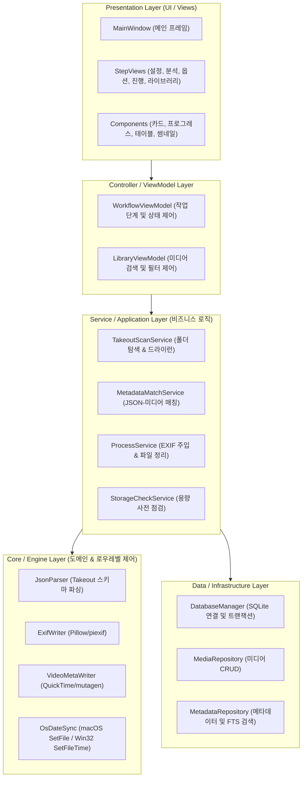

# 00. 프로젝트 아키텍처 및 디자인 패턴 설계서

본 문서는 프로젝트 규모 확장에 유연하게 대처할 수 있도록 **계층형 아키텍처(Layered / Clean Architecture)** 및 **MVVM/MVC 패턴**을 적용한 폴더 구조와 모듈 간 책임 분리를 정의합니다.

---

## 1. 아키텍처 다이어그램



---

## 2. 권장 프로젝트 디렉토리 구조

```text
GooglePhotoTakeoutTools/
├── Doc/                             # 프로젝트 표준 문서함
│   ├── 00_project_architecture.md   # 아키텍처 및 디자인 패턴
│   ├── 01_environment_and_build.md  # 환경 구성 및 빌드 가이드
│   ├── 02_progress_and_roadmap.md   # 마일스톤 및 To-Do 체크리스트
│   ├── 03_tech_stack_and_research.md# 기술 스택 및 조사 자료
│   ├── 04_ui_ux_research.md         # UI/UX 조사 및 화면 설계
│   └── 05_takeout_data_analysis.md  # Takeout 데이터 구조 분석서
│
├── samples/                         # [임시 격리] 개발 및 테스트용 샘플 데이터
│   └── README.md
│
├── src/                             # 프로덕션 소스 코드
│   ├── __init__.py
│   ├── main.py                      # 애플리케이션 진입점 (Entry Point)
│   │
│   ├── core/                        # 도메인 엔진 (로우레벨 메타데이터/OS)
│   │   ├── __init__.py
│   │   ├── parser.py                # JSON 파싱 & NFC 정규화
│   │   ├── matcher.py               # 역방향 탐색 & 파일 매칭 엔진
│   │   ├── exif_writer.py           # 사진 EXIF 기록
│   │   ├── video_writer.py          # 동영상 메타데이터 기록
│   │   └── os_sync.py               # OS별 birthtime/mtime 동기화
│   │
│   ├── services/                    # 비즈니스 로직 & 백그라운드 워커
│   │   ├── __init__.py
│   │   ├── scan_service.py          # 폴더 스캔 및 드라이런 서비스
│   │   ├── process_service.py       # 실행 파이프라인 (QRunnable/QThreadPool)
│   │   └── storage_service.py       # 디스크 용량 사전 점검 (Pre-flight)
│   │
│   ├── data/                        # 데이터 영속성 (SQLite DB)
│   │   ├── __init__.py
│   │   ├── database.py              # SQLite 연결 및 마이그레이션
│   │   ├── models.py                # 데이터 모델 (dataclasses)
│   │   └── repositories/            # 레포지토리 패턴 (CRUD 및 검색)
│   │       ├── __init__.py
│   │       ├── media_repo.py
│   │       └── metadata_repo.py
│   │
│   └── ui/                          # PySide6 프레젠테이션 레이어
│       ├── __init__.py
│       ├── app.py                   # QApplication 초기화
│       ├── main_window.py           # 메인 프레임 윈도우
│       ├── viewmodels/              # 뷰모델 / 컨트롤러
│       │   ├── __init__.py
│       │   ├── workflow_vm.py
│       │   └── library_vm.py
│       ├── views/                   # 단계별 화면 뷰
│       │   ├── setup_view.py        # 1. 폴더 선택 & 용량 체크
│       │   ├── preview_view.py      # 2. 드라이런 분석 통계
│       │   ├── options_view.py      # 3. 정리 규칙 설정
│       │   ├── progress_view.py     # 4. 실시간 진행 모니터링
│       │   └── library_view.py      # 5. 미디어 라이브러리 및 검색
│       ├── components/              # 재사용 가능한 UI 위젯
│       │   ├── progress_card.py
│       │   ├── log_console.py
│       │   └── media_grid.py
│       └── assets/                  # 아이콘, QSS 스타일시트
│
├── tests/                           # 단위 및 통합 테스트
│   ├── __init__.py
│   ├── test_parser.py
│   ├── test_matcher.py
│   └── test_exif_writer.py
│
├── requirements.txt                 # 의존성 패키지 정의
└── .gitignore                       # Git 제외 파일 설정
```

---

## 3. 디자인 패턴 적용 원칙

1. **Repository Pattern (`src/data/repositories`)**:
   - 데이터베이스 접근 로직(SQL 쿼리)을 비즈니스 로직과 완전 격리하여, 쿼리 변경이나 ORM 도입 시 서비스 레이어에 영향이 없도록 합니다.
2. **Strategy Pattern (`src/core/matcher.py`, `src/services/process_service.py`)**:
   - 파일명 매칭 방식(정상 매칭, 역방향 매칭, 정규식 매칭)과 파일 정리 방식(복사 전략, 이동 전략)을 인터페이스로 추상화하여 확장성을 확보합니다.
3. **Observer / Signal-Slot Pattern (`src/ui` $\leftrightarrow$ `src/services`)**:
   - 백그라운드 스레드의 작업 상태를 PySide6의 `Signal`과 `Slot`으로만 전달하여 스레드 안전성(Thread Safety)을 100% 보장합니다.
4. **Separation of Concerns (관심사의 분리)**:
   - UI 코드는 오직 화면 렌더링에만 집중하고, 파일 I/O 및 데이터 처리는 철저히 `services`와 `core`에 위임합니다.
