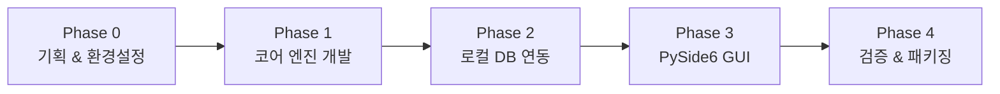

# 02. 프로젝트 진행 상황 및 로드맵 (Checklist)

본 문서는 GooglePhotoTakeoutTools 프로젝트의 전체 마일스톤과 각 단계별 세부 작업 진행 현황을 To-Do 체크리스트 형태로 관리합니다.

---

## 📌 프로젝트 마일스톤 개요

---

## 📋 세부 단계별 체크리스트

### Phase 0: 프로젝트 기획 및 기본 문서화 (현재 진행 중)
- [x] 프로젝트 역할(PM / 직원) 및 기본 운영 규칙 확립
- [x] 기술 스택 확정 (Python + PySide6 + SQLite)
- [x] `/Doc` 표준 문서 체계 구축
  - [x] 개발 환경 및 빌드 가이드 (`01_environment_and_build.md`)
  - [x] 진행 상황 및 로드맵 (`02_progress_and_roadmap.md`)
  - [x] 기술 스택 및 조사 자료 (`03_tech_stack_and_research.md`)
  - [x] UI/UX 조사 및 설계안 (`04_ui_ux_research.md`)
  - [x] Takeout 데이터 구조 분석서 (`05_takeout_data_analysis.md`)
  - [x] 아키텍처 및 디자인 패턴 설계서 (`00_project_architecture.md`)
- [ ] Git 저장소 초기화 (PM 사전 승인 대기)
- [ ] 프로젝트 디렉토리 뼈대 생성 (PM 사전 승인 대기)

---

### Phase 1: 코어 엔진 개발 (Takeout 메타데이터 파서 & 매칭 엔진)
- [ ] JSON 메타데이터 파서 모듈 (`parser`)
  - [ ] `photoTakenTime`, `geoData`, `description` 안전 추출
  - [ ] 유니코드(NFC/NFD) 정규화
- [ ] 파일 매칭 엔진 (`matcher`)
  - [ ] 기본 확장자 매칭 (`.jpg` $\leftrightarrow$ `.jpg.json`)
  - [ ] 이름 잘림 현상 역방향 조회 (`title` 기반 Reverse Lookup)
  - [ ] 중복 번호 `(1)` 불일치 정규식 매칭
  - [ ] 보정본(`-edited`) 및 모션포토 그룹화
- [ ] 메타데이터 주입기 (`writer`)
  - [ ] 사진 EXIF (`DateTimeOriginal`, GPS, ImageDescription) 주입
  - [ ] 동영상 메타데이터 주입
  - [ ] OS별 파일 시스템 날짜(`mtime`, `birthtime`) 동기화
- [ ] 규칙 기반 파일 정리기 (`organizer`)
  - [ ] 복사(Copy) / 이동(Move) 전략 지원
  - [ ] 연도/월별 폴더 계층 생성
  - [ ] JSON 파일 격리/제거

---

### Phase 2: 로컬 데이터베이스 구축 (SQLite)
- [ ] SQLite 스키마 정의 (`media_files`, `metadata`, `fts`)
- [ ] 작업 이력 및 중단/재개(Resume) 상태 트랜잭션 관리
- [ ] 파일 해시(SHA256) 기반 중복 검출 및 인덱싱
- [ ] 키워드/날짜/카메라 기종 고속 검색 쿼리 작성

---

### Phase 3: PySide6 GUI 인터페이스 구현
- [ ] 메인 윈도우 프레임 및 다크/라이트 테마 구성
- [ ] 백그라운드 비동기 워커(`QThreadPool`, `QRunnable`) 및 취소/일시정지 기능
- [ ] Step 1: 폴더 선택 및 디스크 여유 공간 점검(Pre-flight check) 뷰
- [ ] Step 2: 드라이런(Dry-run) 분석 통계 및 차트 뷰
- [ ] Step 3: 정리 옵션(폴더 규칙, 모드 등) 설정 패널
- [ ] Step 4: 실시간 진행률(Progress bar) 및 로그 뷰어
- [ ] Step 5: 로컬 미디어 라이브러리 및 검색 그리드 뷰

---

### Phase 4: 테스트, 최적화 및 크로스플랫폼 패키징
- [ ] 샘플 파일(20~30개) 대상 통합 테스트 수행
- [ ] macOS (.app / .dmg) 빌드 검증
- [ ] Windows (.exe) 빌드 검증
- [ ] 최종 사용자 매뉴얼 작성
