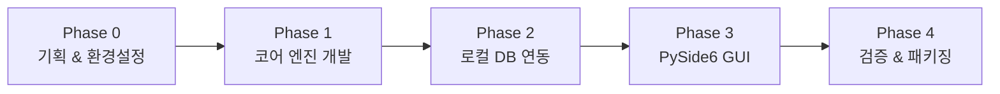

# 02. 프로젝트 진행 상황 및 로드맵 (Checklist)

본 문서는 GooglePhotoTakeoutTools 프로젝트의 전체 마일스톤과 각 단계별 세부 작업 진행 현황을 To-Do 체크리스트 형태로 관리합니다.

---

## 📌 프로젝트 마일스톤 개요

---

## 📋 세부 단계별 체크리스트

### Phase 0: 프로젝트 기획 및 기본 문서화 (완료)
- [x] 프로젝트 역할(PM / 직원) 및 기본 운영 규칙 확립
- [x] 기술 스택 확정 (Python + PySide6 + SQLite)
- [x] `/Doc` 표준 문서 체계 구축
  - [x] 개발 환경 및 빌드 가이드 (`01_environment_and_build.md`)
  - [x] 진행 상황 및 로드맵 (`02_progress_and_roadmap.md`)
  - [x] 기술 스택 및 조사 자료 (`03_tech_stack_and_research.md`)
  - [x] UI/UX 조사 및 설계안 (`04_ui_ux_research.md`)
  - [x] Takeout 데이터 구조 분석서 (`05_takeout_data_analysis.md`)
  - [x] 아키텍처 및 디자인 패턴 설계서 (`00_project_architecture.md`)
  - [x] 오픈소스(gpth, immich-go) 벤치마크 및 메타데이터 심층 분석서 (`06_opensource_benchmark_analysis.md`)
- [x] Git 저장소 초기화 (`git init`) 및 `.gitignore`에 `Sample/` 경로 완벽 제외
- [x] 프로젝트 디렉토리 뼈대 생성 (`src/`, `tests/`, `requirements.txt`)
- [x] Initial commit 생성 (`a94a683`)

---

### Phase 1: 코어 엔진 개발 (Takeout 메타데이터 파서 & 매칭 엔진 - 완료)
- [x] 도메인 모델 설계 (`src/core/models.py`)
  - [x] `MediaMetadata`, `MediaFile`, `GeoLocation`, `MatchResult` 정의
- [x] 크로스플랫폼 유틸리티 (`src/core/utils.py`)
  - [x] macOS NFD 한글 자소 분리 방지 (`unicodedata.normalize('NFC')`)
  - [x] 파일명 날짜 정규식 파서 (Fallback 대응)
- [x] JSON 메타데이터 파서 모듈 (`src/core/parser.py`)
  - [x] `photoTakenTime`, `creationTime`, `geoData`, `description`, `people` 안전 추출
- [x] 다단계 휴리스틱 파일 매칭 엔진 (`src/core/matcher.py`)
  - [x] 디렉토리 사전 인덱싱 (`DirectoryMetadataIndex`)을 통한 고속 매칭
  - [x] 1단계: 완전 일치 (`.json`, `.supplemental-metadata.json`)
  - [x] 2단계: 중복 번호 `(1)` 불일치 정규식 매칭
  - [x] 3단계: 한국어 수정본(`-수정됨`) 및 영문(`-edited`) 원본 역추적
  - [x] 4단계: 역방향 제목 조회 (`title` Reverse Lookup)
  - [x] 5단계: 46~51자 파일명 잘림 접두사 매칭
  - [x] 6단계: 파일명 날짜 Fallback
- [x] 메타데이터 주입기 (`src/core/exif_writer.py`)
  - [x] `DateTimeOriginal`, `DateTimeDigitized`, `ImageDescription`, GPS 좌표 주입
  - [x] 썸네일 64KB 초과 자동 방어
- [x] OS별 파일 시스템 날짜(`mtime`, `birthtime`) 동기화 (`src/core/os_sync.py`)
  - [x] macOS `SetFile` / Windows `SetFileTime` / 공통 `os.utime`
- [x] 주입 전/후 파일 변화 실측 검증 (`samples/run_demo_inspection.py`)
- [x] 규칙 기반 파일 정리기 (`src/services/process_service.py`)
  - [x] `YYYY/MM` 등 다중 계층 폴더 생성
  - [x] JSON 파일 완전 분리 (출력 디렉토리에 미디어 파일만 정돈)
  - [x] SHA-256 해시 기반 중복 파일 스킵
  - [x] 메타데이터 풍부도 우선순위 정렬 파이프라인
- [x] 단위 테스트 작성 및 통과 (12/12 OK)

---

### Phase 2: 로컬 데이터베이스 구축 (SQLite - 완료)
- [x] SQLite 스키마 및 DB 매니저 (`src/data/database.py`)
  - [x] `media_files` 테이블 및 해시 인덱스
  - [x] `metadata` 테이블 및 날짜 인덱스
  - [x] FTS5 풀텍스트 가상 테이블
- [x] 미디어 레포지토리 (`src/data/repositories/media_repo.py`)
  - [x] 해시 기반 중복 조회 (`find_by_hash`)
  - [x] 미디어 & 메타데이터 트랜잭션 적재 (`insert_media`)
  - [x] 라이브러리 전체 통계 (`get_statistics`)
  - [x] 키워드, 연/월, 미디어 유형, GPS 복합 고속 검색 (`search_media`)
- [x] 실제 사용자 샘플 201개 파일 대상 통합 파이프라인 검증 완료
  - [x] **201/201개 파일 2.53초 만에 정리 완료 (오류 0건, JSON 0건)**

---

### Phase 3: PySide6 GUI 인터페이스 구현

#### Phase 3-A: 마법사(Wizard) 초기 구현 (완료 → Phase 3-B로 대체)
- [x] 마법사 방식 4단계 기본 UI 구현 (Wizard 스타일, 다크 테마)
- [x] 백그라운드 비동기 워커(`QThreadPool`, `QRunnable`) 및 취소 기능
- [x] 메인 진입점 연결 (`src/main.py`) 및 경로 오류 수정

#### Phase 3-B: 사이드바 네비게이션 UI 재설계 (완료 — 2026-11-17)
- [x] UI 재설계 분석 문서 작성 (`Doc/07_ui_redesign_sidebar_analysis.md`)
- [x] **라이트 모드** 디자인 시스템 구축 (`src/ui/theme.py` 전면 재작성)
- [x] ChatGPT 방식 사이드바 토글 컴포넌트 (`src/ui/components/sidebar_widget.py`)
- [x] 메인 윈도우 사이드바 + QStackedWidget 구조로 전면 재설계 (`src/ui/main_window.py`)
- [x] 대시보드 뷰: 통계 카드 + 최근 작업 목록 (`src/ui/views/dashboard_view.py`)
- [x] 새 작업 뷰: 서브스텝 방식 (폴더선택→미리보기→진행→완료) (`src/ui/views/job_view.py`)
- [x] 처리 이력 뷰: 날짜 + 앨범 단위 작업 이력 테이블 (`src/ui/views/history_view.py`)
- [x] 미디어 라이브러리 뷰: SQLite FTS 복합 검색 (기존 유지 + 라이트 모드 적용)
- [x] 설정 뷰: 처리 기본값 + 앱 버전 정보 (`src/ui/views/settings_view.py`)
- [x] DB 집계 쿼리 추가: `get_statistics()`, `get_recent_jobs()`, `get_history_summary()` (`src/data/database.py`)
- [x] 전체 모듈 임포트 검증 완료
- [x] 단위 테스트 12/12 모두 통과
- [x] Git 커밋 완료 (`c6bc936`)

---

### Phase 4: 테스트, 최적화 및 크로스플랫폼 패키징 (완료 — 2026-11-17)
- [x] OS별 시스템 기본 한글/영문 폰트 스택 최적화 및 폰트 경고 제거 (`src/ui/theme.py`)
- [x] PyInstaller 빌드 사양서 정의 (`GooglePhotoTakeoutTools.spec`)
- [x] macOS 단일 실행형 `.app` 번들 원클릭 빌드 스크립트 작성 (`scripts/build_mac.sh`)
- [x] Windows 단일 실행형 `.exe` 원클릭 빌드 스크립트 작성 (`scripts/build_windows.bat`, `build_windows.ps1`)
- [x] macOS M시리즈(Apple Silicon arm64) 환경에서 `.app` 번들 실제 빌드 검증 성공 (`dist/GooglePhotoTakeoutTools.app`, 95MB)
- [x] 개발 환경 및 빌드 가이드 문서 갱신 (`Doc/01_environment_and_build.md`)
