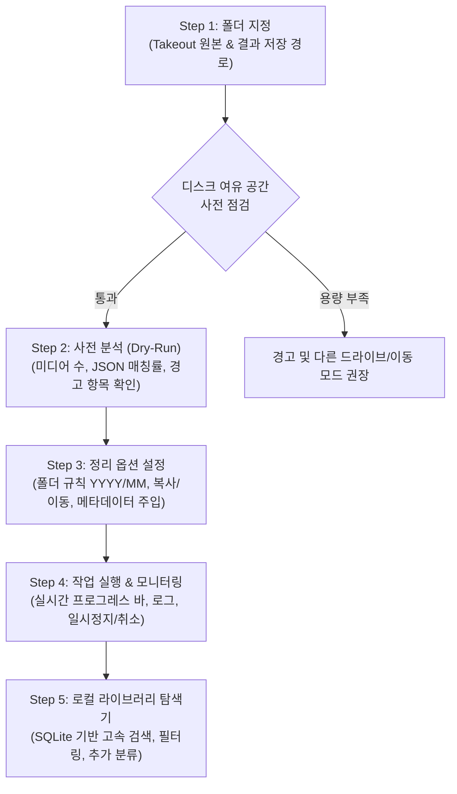

# 04. UI/UX 조사 및 디자인 설계 분석 자료

본 문서는 일반 사용자도 CLI 없이 쉽고 안전하게 Google Takeout 데이터를 정리할 수 있도록 설계된 UI/UX 디자인 워크플로우와 화면 구성을 정의합니다.

---

## 1. UX 디자인 핵심 원칙

1. **안전성(Safety First)**: 실제 파일 이동/변경 전 **사전 검사(Dry-Run)** 결과를 시각적으로 보여주어 데이터 유실 불안감 해소.
2. **명확성(Clarity)**: 진행률, 처리 속도, 남은 시간, 에러 발생 내역을 실시간으로 투명하게 제공.
3. **간결성(Simplicity)**: 3~4번의 클릭만으로 기본 정리가 완료되도록 스마트 기본값(Defaults) 제공.
4. **연속성(Continuity)**: 정리 완료 후 앱을 닫지 않고, 내장 라이브러리 뷰어를 통해 즉시 사진을 검색하고 추가 분류할 수 있는 환경 제공.

---

## 2. 사용자 여정 (User Flow)

---

## 3. 화면별 세부 레이아웃 설계

### 3.1. 화면 1: 폴더 선택 & 사전 분석 뷰 (Setup & Pre-check)
* **상단 헤더**: 단계 표시 인디케이터 (1. 설정 $\rightarrow$ 2. 분석 $\rightarrow$ 3. 옵션 $\rightarrow$ 4. 실행 $\rightarrow$ 5. 라이브러리)
* **경로 선택 카드**:
  - 원본 Takeout 경로 (드래그 앤 드롭 지원)
  - 정리 대상 경로 (드래그 앤 드롭 지원)
* **드라이브 용량 인디케이터**:
  - 원본 필요 용량 vs 대상 드라이브 남은 공간 시각 바 표시

### 3.2. 화면 2: 드라이런 분석 카드 (Analysis Dashboard)
* **요약 통계 카드 4종**:
  - 총 발견 파일 수 (사진 / 동영상 / JSON)
  - JSON 매칭 성공률 (%)
  - 주의/경고 파일 (파일명 잘림, 중복 번호 등)
  - 예상 소요 시간
* **분석 세부 테이블**: 매칭 실패 파일 및 원인 표시

### 3.3. 화면 3: 분류 규칙 설정 패널 (Options)
* **폴더 구조 선택기 (라디오/콤보박스)**:
  - `연도/월 (YYYY/MM/)` (기본값)
  - `연도/연도-월 (YYYY/YYYY-MM/)`
  - `앨범명 우선 (Album/YYYY-MM/)`
* **동작 모드 토글**:
  - 안전 복사(Copy) vs 디스크 절약 이동(Move)
* **메타데이터 보정 옵션**:
  - 파일 시스템 수정일/생성일 동기화 (권장 ON)
  - GPS 누락 파일에 JSON 위치 주입 (권장 ON)
  - Google 포토 설명(캡션) 주입 (권장 ON)

### 3.4. 화면 4: 실행 및 실시간 모니터링 뷰 (Progress)
* **대형 프로그레스 바**: 전체 진행률 (%)
* **상태 메트릭**: 현재 파일명, 처리 속도(files/sec), 경과 시간 및 남은 시간
* **컨트롤 버튼**: `일시 정지(Pause)`, `작업 취소(Cancel)`
* **로그 콘솔 창**: 상세 진행 로그 및 에러 목록 실시간 스크롤

### 3.5. 화면 5: 로컬 미디어 탐색기 (Media Library Explorer)
* **좌측 사이드바 필터**:
  - 날짜 타임라인 (연도/월별 트리)
  - 미디어 타입 (사진, 동영상, 즐겨찾기)
  - 카메라 모델 (iPhone, Galaxy 등)
* **상단 검색바**: 캡션 키워드, 파일명 FTS 고속 검색
* **중앙 썸네일 그리드**: 처리된 사진/동영상 미리보기 및 메타데이터 인스펙터
