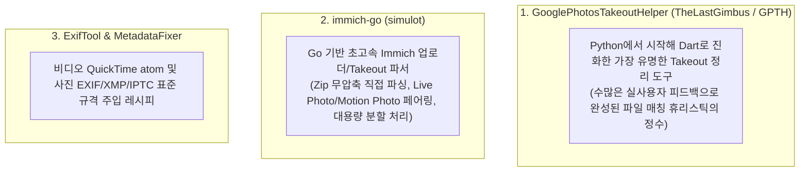
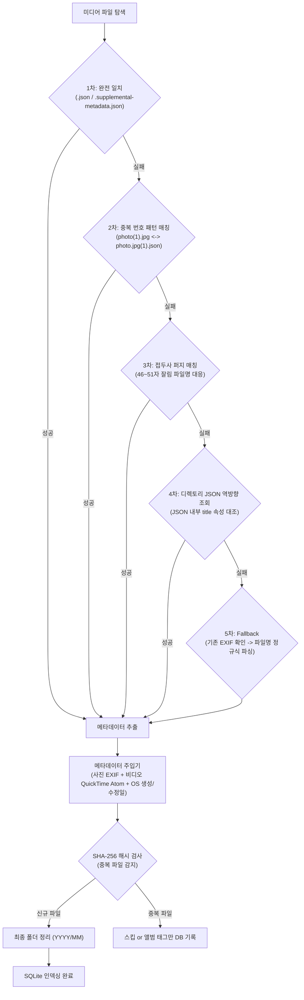

# 06. 오픈소스 벤치마크 및 심층 메타데이터 분석 보고서

본 문서는 Google Takeout Photos 데이터 정리 분야에서 가장 검증된 글로벌 오픈소스 프로젝트인 **GooglePhotosTakeoutHelper (`gpth`)**와 **`immich-go`**, 그리고 관련 도구들의 내부 소스코드와 아키텍처를 심도 있게 분석한 결과입니다.

---

## 1. 분석 대상 대표 오픈소스 개요

| 프로젝트 | 언어 | 핵심 강점 | 벤치마킹 포인트 |
| :--- | :--- | :--- | :--- |
| **GooglePhotosTakeoutHelper** | Python $\rightarrow$ Dart | 수년간 축적된 Takeout 네이밍 변칙/잘림(Truncation) 대응 | 5단계 JSON 매칭 휴리스틱, 보정본(`-edited`) 처리, 파일명 날짜 Fallback |
| **immich-go** | Go | 압축 해제 없는 직접 스트리밍, 대용량 멀티 zip 처리, Live Photo 페어링 | Zip 직접 읽기 아키텍처, Live/Motion Photo 자동 묶기, 타임존 오프셋 계산 |
| **ExifTool 공식 레시피** | Perl / C | 사진/동영상 메타데이터 표준 규격 완벽 준수 | QuickTime `CreationDate` vs `CreateDate`, UTC/로컬 타임존 보정 |

---

## 2. Google Takeout의 6대 숨은 함정과 오픈소스들의 극복 기법

### 1) `.supplemental-metadata.json` 접미사 및 파일명 잘림 (Truncation)
* **현상**: 최근 Google Takeout은 단순 `.json` 대신 `.supplemental-metadata.json`이라는 긴 확장자를 붙이기 시작했습니다. 파일 시스템 또는 구글 내부의 46~51자 파일명 제한(Truncation limit)에 걸리면서 접미사 뒤쪽이 잘려나갑니다.
  - 예: `very_long_photo_name_2023.jpg.suppl.json`
  - 예: `very_long_photo_name_2023.jpg.supplemental-met.json`
* **해결 알고리즘 (gpth 방식)**:
  1. 완전 일치(`filename + ".json"`) 우선 검색.
  2. 완전 일치(`.supplemental-metadata.json`) 검색.
  3. 실패 시, 동일 디렉토리 내에서 파일명의 앞부분(Prefix Root)을 공유하면서 `.suppl...` 또는 `.json`으로 끝나는 파일을 탐색하는 **접두사 기반 유연 매칭(Prefix Fuzzy Matching)** 수행.
  4. 그래도 실패 시, 디렉토리 내의 모든 JSON을 열어 내부 `"title"` 속성과 파일명을 대조하는 **역방향 인덱스(Reverse Lookup)** 수행.

---

### 2) 중복 번호 매김 불일치 (`(1)`, `(2)`)
* **현상**: 동일 파일명이 존재할 때 구글 포토는 괄호 위치를 임의로 바꿉니다.
  - 미디어 파일: `IMG_1234(1).jpg`
  - JSON 파일: `IMG_1234.jpg(1).json` 또는 `IMG_1234(1).jpg.json` 또는 `IMG_1234(1).jpg(1).json`
* **해결 알고리즘**:
  - 정규식 패턴 `r"^(.*?)(?:\((\d+)\))?(\.[^.]+)$"`을 사용하여 `(베이스이름, 카운터, 확장자)`를 분해한 뒤, 가능한 모든 JSON 조합 후보군 3~4개를 순차적으로 질의(Probe)합니다.

---

### 3) 라이브 포토(Live Photo) 및 모션 포토(Motion Photo) 페어링
* **iOS Live Photo**:
  - `IMG_0001.HEIC` (정지 사진) + `IMG_0001.MOV` (3초 영상)으로 구성됩니다.
  - JSON은 보통 사진에만 붙어 있거나 둘 다 존재하지만 촬영일시는 완벽히 일치합니다.
  - **해결책 (`immich-go` 벤치마킹)**: 동일한 베이스 파일명을 가진 정지 영상과 비디오를 단일 에셋(Asset)으로 묶고, 사진의 `photoTakenTime`과 GPS를 비디오에도 동일하게 적용하여 정리 후에도 같은 날짜 폴더에 나란히 배치되도록 보장합니다.
* **Android Motion Photo**:
  - `MVIMG_*.jpg` 또는 파일 내부에 마이크로 비디오가 내장되어 있습니다. 이 경우 사진 메타데이터만 갱신하면 모션 비디오도 함께 유지됩니다.

---

### 4) 동영상(MP4/MOV)의 타임존(Timezone) 시차 왜곡 문제
* **현상**: QuickTime 스펙상 `QuickTime:CreateDate`는 표준시(UTC)로 저장되어야 합니다. 로컬 시간을 그대로 집어넣으면 뷰어에서 **한국 시간 기준 9시간 전(또는 시차만큼)**으로 표시되는 치명적인 오류가 발생합니다.
* **해결책**:
  - JSON의 `photoTakenTime.timestamp` (Unix Epoch - 절대 시간)를 기준으로 변환합니다.
  - QuickTime 메타데이터에는 로컬 오프셋이 포함된 `QuickTime:CreationDate` (예: `2023:05:15 12:30:45+09:00`) 태그와 UTC 기준의 `QuickTime:CreateDate`를 정확히 구분하여 기록해야 합니다.

---

### 5) 앨범 중복 및 해시 기반 단일화
* **현상**: Google 포토 앨범에 사진을 등록해 두면, `Photos from 2023` 폴더와 `내 앨범명` 폴더 양쪽에 물리적으로 동일한 파일이 2개 다운로드됩니다.
* **해결책**:
  - 파일 내용의 **SHA-256 해시**를 계산하여 DB에 기록하고, 이미 처리된 해시의 파일은 복사/이동을 건너뛰고 앨범 메타데이터(태그)만 DB에 추가합니다. (저장 공간 최대 30~50% 절약 가능)

---

### 6) JSON 유실 시의 최후 폴백 (Fallback Strategy)
* **현상**: 구글의 오류로 특정 사진의 JSON이 아예 누락되거나 분실된 경우가 있습니다.
* **해결책 (gpth 벤치마킹)**:
  - 1단계: 원본 미디어 자체에 이미 EXIF(`DateTimeOriginal`)가 남아있는지 확인 $\rightarrow$ 남아있다면 그대로 신뢰.
  - 2단계: 파일명 파싱 (예: `IMG_20230515_123045.jpg`, `Screenshot_2023-05-15-12-30-45.png`, `PXL_...`) 정규식으로 날짜 추출.
  - 3단계: 파일 시스템 수정일(`mtime`).

---

## 3. 우리 프로젝트에 적용할 최적의 핵심 파이프라인 설계

오픈소스들의 장점만을 결합하여 우리 프로젝트에 다음과 같은 고유 아키텍처를 적용합니다:

