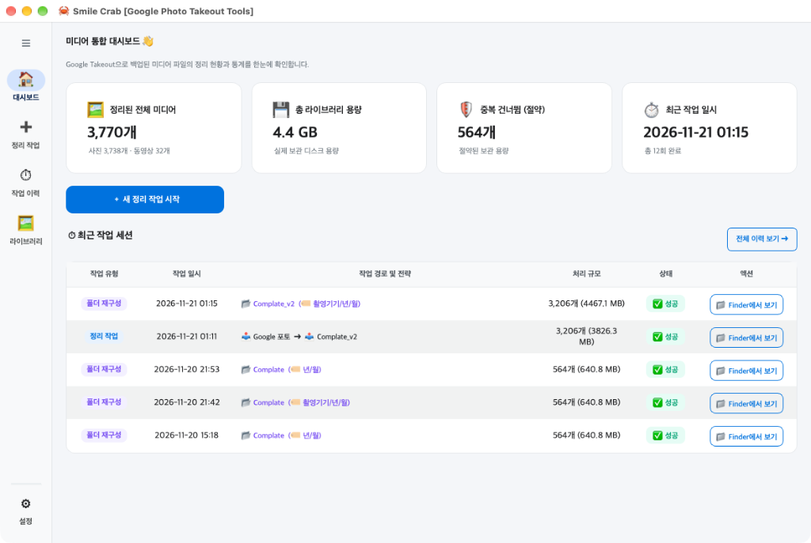
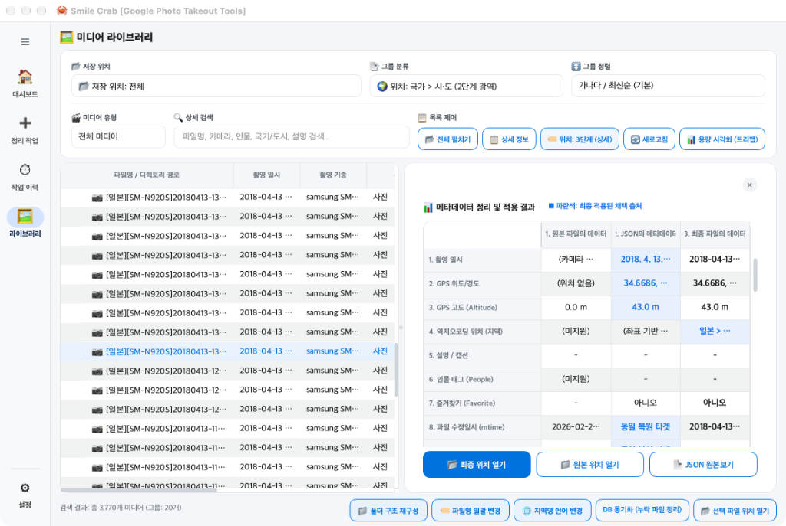

# Smile Crab [Google Photo Takeout Tools]
> **스마일크랩 - 구글포토 테이크아웃 툴**  
> *Google Photos Takeout 데이터의 구조적 결함을 완벽히 해결하고, 안전한 무손실 메타데이터 복원 및 지능형 미디어 관리를 제공하는 올인원 데스크톱 솔루션*

---

## 📖 소개 (Introduction)

**Smile Crab (스마일크랩)**은 Google Takeout을 통해 다운로드한 사진 및 동영상 파일의 분리된 메타데이터(Sidecar JSON)를 미디어 바이너리에 안전하게 복원하고, 원하는 규칙으로 파일명과 디렉토리 구조를 체계적으로 재배치해 주는 올인원 데스크톱 도구입니다.

구글 포토 테이크아웃 데이터의 4대 고질적 문제(메타데이터 분리, 파일 생성일 왜곡, 47/51자 파일명 잘림, 앨범별 중복 복사)를 100% 로컬 오프라인 환경에서 무손실(Zero Data Loss)로 해결합니다.

> ⚠️ **AI 기반 개발 안내 및 사용 시 주의사항 (Disclaimer)**
> - 본 프로젝트는 **생성형 AI를 이용하여 설계 및 개발**되었습니다.
> - 폭넓은 시나리오 테스트와 데이터 무결성 검증을 거쳤으나, 미디어 포맷의 다양성과 Google Takeout 원본 데이터의 복잡성으로 인해 **100% 완벽한 동작을 보장하지는 않습니다.**
> - 소중한 추억이 담긴 미디어 파일을 다루는 만큼, **작업 완료 후 결과물(촬영 일시, 위치, 파일 수 등)을 반드시 확인**하시길 권장하며, 원본 압축 파일이나 별도의 백업본을 보관한 상태에서 사용하시길 권장합니다.

---

## ✨ 핵심 기능 (Key Features)

### 1. 🧬 미디어-메타데이터 5단계 정밀 매칭 엔진
- **1단계 (Exact Direct Match)**: 파일명 1:1 직접 매칭 (`IMG_1234.jpg` ➔ `IMG_1234.jpg.json`)
- **2단계 (Numbering Normalization)**: 구글의 불규칙한 괄호 중복 번호 표기 교차 매핑 (`IMG_1234(1).jpg` ➔ `IMG_1234.jpg(1).json`)
- **3단계 (Truncation Reversal)**: 47자~51자 길이 제한으로 잘려나간 JSON 파일명 역추적
- **4단계 (Edited Derivative)**: 필터/회전 등 구글 포토 편집본의 원본 메타데이터 자동 상속
- **5단계 (Timestamp Verification)**: 파일 내부 잔존 헤더 시간과 JSON 시간의 오차 교차 검증 (±60초)

### 2. 🌍 17만 거점 오프라인 GPS 역지오코딩 & 3단계 지명 계층화
- **172,038개 전 세계 도시(GeoNames)** K-D Tree 2D 공간 색인 탑재 (사진 1장당 0.05ms 초고속 처리)
- **100% 로컬 오프라인**: 인터넷 연결 및 외부 API 호출 불필요, 개인 위치 정보 유출 제로
- **3단계 표준 행정구역화**: `국가 ➔ 주/도 ➔ 시/군/구` 및 600대 주요 관광 명소 우선 보정
- **GPS 지명 표기 언어**: **한국어(Korean)** 및 **영어(English)** 2가지 언어 지원

### 3. 🏷️ 지능형 파일명 일괄 변경 마법사 (Batch Rename)
- 촬영일시, 카메라 제조사/기종, 국가/도시 위치 등 풍부한 메타데이터 기반 실시간 토큰 조합
- 구분자(언더바, 하이픈 등), 대소문자 변환, 괄호 스타일 커스텀 옵션 및 실시간 라이브 미리보기

### 4. 📁 초고속 무손실 미디어 폴더 구조 재구성 마법사 (Reorganize)
- 10종 맞춤형 보관 전략 (`년/월`, `년/월/일`, `촬영기기/년/월`, `국가/도시/년/월` 등)
- 동일 드라이브 내 제자리(In-place) 고속 재배치 및 신규 대상 드라이브로의 정리 지원
- 이동 후 남은 빈 디렉토리 자동 청소 및 동일 파일명 충돌 방지 번호 매김

### 5. 🌐 지역명 언어 일괄 변경 마법사 (Geo-Language Relabeler)
- 이미 정리된 미디어의 GPS 좌표를 기반으로 DB 내 지명 표기를 한국어 ↔ 영어로 언제든지 무손실 일괄 재변환
- 파일 이동이나 디스크 변경 없이 메타데이터만 100% 안전하게 고속 갱신 후 폴더 재구성/파일명 변경과 즉시 연계

### 6. 🔍 스마트 검사 및 시각화 도구
- **11개 주요 메타데이터 Before/After 가로 정밀 대조표** & Raw EXIF / QuickTime atom 인스펙터
- **인터랙티브 Squarified Treemap**: 날짜, 카메라, 위치, 폴더 계층별 디스크 점유율 시각화 탐색
- **비동기 멀티스레딩(QThreadPool)** & **SQLite3 로컬 색인 FTS5 고속 검색**

### 7. 🌐 다국어 지원 및 시스템 최적화
프로그램은 다국어 인터페이스를 지원하며, 언어 체계는 다음과 같이 구분되어 동작합니다:
- **프로그램 UI 표시 언어 (6개 국어 지원)**:
  - 🇰🇷 한국어, 🇺🇸 English, 🇯🇵 日本語, 🇨🇳 简体中文, 🇹🇼 繁體中文(台灣), 🇭🇰 繁體中文(香港)
  - 메뉴, 대화상자, 도움말, 라이선스 등 프로그램의 모든 UI 텍스트에 적용되며 실시간 무중단 언어 전환 지원
- **GPS 지명 표기 언어 (2개 국어 지원)**:
  - 🇰🇷 **한국어**, 🇺🇸 **영어**
  - *참고: 전체 프로그램 UI는 6개 국어를 지원하지만, 지리 데이터 색인 기반의 GPS 좌표 ➔ 지명(국가/도시) 변환은 현재 **한국어**와 **영어** 2종류를 지원합니다.*
- **시스템 최적화**:
  - 대용량 파일 정리 중 시스템 절전 모드 진입 방지 (Smart Wakelock)
  - OS 네이티브 파일 탐색기(macOS Finder / Windows Explorer) 및 클립보드 연동

---

## 🛠️ 기술 스택 (Tech Stack)

- **Language**: Python 3.9+
- **GUI Framework**: PySide6 (Qt for Python)
- **Image Processing**: Pillow (PIL Fork), piexif
- **Database**: SQLite3 (FTS5 Search, K-D Tree Index)
- **Operating Systems**: macOS, Windows 10/11, Linux

---

## 🚀 시작하기 (Getting Started)

### 1. 저장소 클론
```bash
git clone https://github.com/bhchhjc/SmileCrab_GooglePhotoTakeoutTools.git
cd SmileCrab_GooglePhotoTakeoutTools
```

### 2. OS 환경별 실행 방법 (개발 모드)

#### 🍎 macOS
```bash
# 가상환경 생성 및 활성화
python3 -m venv venv
source venv/bin/activate

# 의존성 패키지 설치
pip install -r requirements.txt

# 애플리케이션 실행
python -m src.main
```

#### 🪟 Windows
```powershell
# 가상환경 생성 및 활성화 (PowerShell 기준)
python -m venv venv
.\venv\Scripts\Activate.ps1
# (명령 프롬프트 CMD의 경우: venv\Scripts\activate.bat)

# 의존성 패키지 설치
pip install -r requirements.txt

# 애플리케이션 실행
python -m src.main
```

---

### 3. 배포용 단독 실행 파일 빌드 (Packaging)

배포용 실행 파일(`.app` 또는 `.exe`)을 빌드할 때는 가상환경에 `pyinstaller`를 설치한 후 제공되는 빌드 스크립트를 실행합니다:

```bash
# 빌드 도구 설치
pip install pyinstaller
```

#### 🍎 macOS (`.app` 번들 빌드)
```bash
chmod +x scripts/build_mac.sh
./scripts/build_mac.sh
```
- **빌드 산출물**: `dist/GooglePhotoTakeoutTools.app`
- **실행**: `open dist/GooglePhotoTakeoutTools.app`

#### 🪟 Windows (`.exe` 실행 파일 빌드)
- **PowerShell**:
  ```powershell
  .\scripts\build_windows.ps1
  ```
- **명령 프롬프트 (CMD)**:
  ```cmd
  scripts\build_windows.bat
  ```
- **빌드 산출물**: `dist\GooglePhotoTakeoutTools\GooglePhotoTakeoutTools.exe`

---

## 📸 스크린샷 (Screenshots)


|  |  |
| :---: | :---: |
| 홈 화면 | 미디어 라이브러리 (상세 보기) |

---

## 📜 라이선스 (License)

본 프로젝트는 **MIT License**에 따라 자유롭게 사용 및 수정, 배포할 수 있습니다.  
자세한 내용은 [LICENSE](LICENSE) 파일 및 앱 내부의 `설정 ➔ 오픈소스 라이선스` 탭을 참조하세요.
